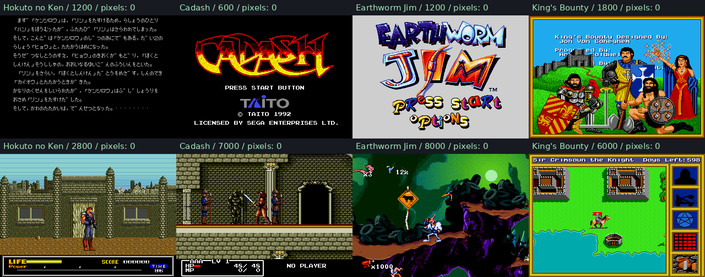

# Four-cartridge oracle fidelity review

Completed 2026-10-13 against canonical `../mdx`. The unchanged Genesis Plus GX
core remains the independent execution authority. The current release binary
is rebuilt; changes in the toolkit checkout are uncommitted.

## Results

All **27 distinct requested frame/input image checkpoints** match every pixel:
12 existing gates plus17 survey comparisons, with two overlapping cases.
At each of the17 fresh survey checkpoints, VRAM, CRAM, VSRAM and VDP registers
also match exactly, and there are no reported CPU exceptions.

| Game | New surveyed frames | Furthest capture |
|---|---|---:|
| Hokuto no Ken | 60,300,1200,2800,4000,6000 | 6000 |
| Cadash | 600,5500,7000 | 7000 |
| Earthworm Jim | 1200,2800,6000,7000,8000 | 8000 |
| King's Bounty | 1800,4500,6000 | 6000 |

The extended replays exercise directional/action inputs and then continue to
the named checkpoints. They do not establish completion of a level or game.
Hokuto2800 is gameplay; its extended6000 capture is a story screen. Cadash7000
extends the original scrolling replay with released inputs. The preview uses
representative intro/title/gameplay images with their actual frame labels.



## What changed

The previously independent-looking visual discrepancies shared scheduler causes:

- **CPU bit-operation costs:** static absolute-long BTST is20 clocks, not8;
  register, memory, immediate and dynamic forms use their reference costs.
- **Console refresh waits:** a periodic14-master-clock wait is separate from
  opcode timing and advances device clocks.
- **Hard reset and frame geometry:** CPU release uses the hardware-derived NTSC
  phase and initial192-line Mode4 frame; later geometry latches on completion.
- **VDP write FIFO:** four-word deadline queue, H32/H40 access slots and live
  empty/full status apply CPU backpressure, separate from external DMA waits.
- **VINT:** asserted770/788 master clocks after VBLANK, with fractional-clock
  precision. Controller changes retain their original frame numbering.

The API review also corrected vectors, cartridge offsets, stop-point coverage,
RAM range/alias handling, replay annotations/schema discovery, offline bundled
CPU conformance and sign-extended short-address display. Sound-bus/FM behavior
was independently checked and corrected. Existing BCD-family fixes were
preserved and exercised; Hokuto's former17-pixel HUD difference is closed.

Independent traces observe the missing FIFO stall at KB `$278C6`, periodic
refresh gaps before scene entry, and Cadash's consumed wave operands/update
frames. The shared fixes preserve all12 original reference images and inputs.

## Verification and artifacts

- **156** canonical release Rust tests passed; **9** historical/external probes
  remain ignored in the default suite. The bit-timing probe is now enabled.
- **4** Python observer tests passed in both checkouts.
- **12** unchanged original image gates passed.
- A new frozen17-case image regression passed, with ROM/input/reference hashes.
- Fresh final-binary17-case `--verify` survey passed against newly run GPGX.

Identity-bound report: [`evidence/fidelity-review.json`](evidence/fidelity-review.json).
Frozen cases: `testdata/oracle_fidelity/manifest.json`.
Reproduction:

```sh
.venv/bin/python tools/cartridge_survey.py --all --verify --out .mdx/NEW-DIRECTORY
MDX_GOLDEN_BINARY=/home/maisy/opencode_projects/mdx/target/release/mdx \
  cargo test -p mdx --release --test kings_bounty_boot --test cadash_boot \
  --test cartridge_fidelity -- --ignored
```

Full captures, normalized buffers and difference images are in
`.mdx/fidelity-review/release-verified/`. Timing evidence is in the sibling
`kb-investigation/` and `cadash-investigation/` directories. The report preserves
source/binary/oracle/input/reference identities. Raw oracle save-state digests
can vary in noncanonical fields between processes; comparison uses explicit
normalized buffers and image pixels.

## External notes and remaining bounds

Read [`external-agent-review.md`](external-agent-review.md) and
[`sound-bus-review.md`](sound-bus-review.md) before trusting the supplied notes.
Their PC+4 branch target correction, VDP register map, and cartridge-read
interpretation of an absolute-short WRAM operand were incorrect.

Video equality does not establish whole-machine equality. Some non-video WRAM
snapshots still differ; those bytes have not been proven unused. The full report
preserves counts and first offsets. Bus timing and FIFO data effects remain
instruction-granular, long-instruction refresh suppression is incomplete, and
sound synthesis is not implemented. These finite gates do not claim whole-game,
general CPU-cycle, audio or raster-history equivalence.

Restart an already-running MDX MCP connection to load the rebuilt binary and
revised schemas.
